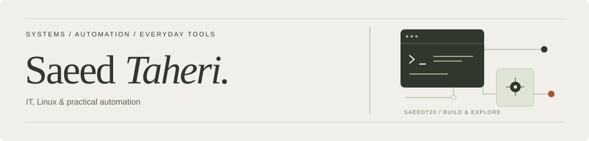
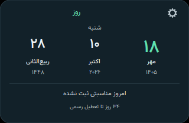
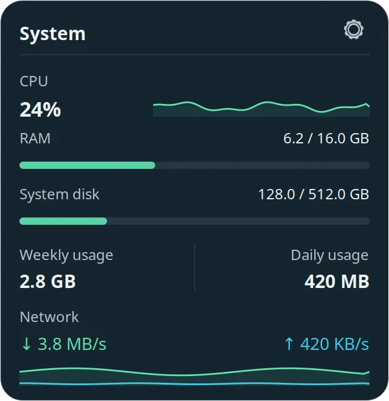

**IT professional · AI & automation enthusiast**

I’m based in **Bangkok**. I work with Linux, Python, and AI agents to build desktop tools and automate everyday tasks, while developing my web skills.

**[Website](https://saeedt.ir/) · [Email](mailto:info@saeedt.ir)**

> Available for freelance work in IT/Linux, AI automation, and web development, and for personal or open-source collaboration.

## Featured work

### [Roozlet](https://github.com/saeedt20/Roozlet)

An offline Persian calendar for **Linux Mint / Xfce**, with a compact desktop card
and a full month view. English/Persian interfaces, independent digits, bundled
Vazirmatn, and verified Iranian occasions and holidays for **1405**.

`Python` · `GTK 3` · `Cairo` · `MIT`

[Source & documentation](https://github.com/saeedt20/Roozlet) · [Download .deb](https://github.com/saeedt20/Roozlet/releases/latest)

View the desktop card

_Actual GTK interface on Linux Mint Xfce. Official event and Hijri coverage is limited to 1405._

### [CouchZap](https://github.com/saeedt20/couchzap)

A lightweight IPTV player for **Android TV boxes and phones**. Import a local
playlist, browse with a TV remote or touchscreen, and play streams with Media3.
The app uses your own playlists; no channels or subscriptions are bundled.

`Kotlin` · `Android` · `Media3`

[Source & build instructions](https://github.com/saeedt20/couchzap) · [Report an issue](https://github.com/saeedt20/couchzap/issues)

### [TallyDesklet](https://github.com/saeedt20/tallydesklet)

A compact Linux desktop widget that brings CPU, memory, disk, network speed, and daily and weekly data usage into one view. Built for **Xfce on X11**; measurements stay on your computer.

`Python` · `GTK 3` · `Cairo` · `psutil`

[Source & documentation](https://github.com/saeedt20/tallydesklet) · [Download](https://github.com/saeedt20/tallydesklet/releases/latest)

View the interface

_Actual GTK interface with illustrative example data._

### More projects

| Project                                        | What it does                                                                           |
| ---------------------------------------------- | -------------------------------------------------------------------------------------- |
| **[GeminiShop](https://t.me/GeminiRedeemBot)** | Brings trusted subscription and digital-key sellers together in a curated marketplace. |
| **[NumberFlare](https://t.me/NumberFlareBot)** | A virtual-number storefront with cryptocurrency and credit-card payments.              |
| **[Personal website](https://saeedt.ir/)**     | My portfolio, background, and projects in Persian and English.                         |

## What I work on

- **Linux & systems:** troubleshooting, system log analysis, networking, and security issues.
- **Agents & automation:** Telegram agents, email replies, scheduled GitHub tasks, cron jobs, and website support.
- **Desktop & Android apps:** native GTK desktop tools and a Kotlin/Media3 player for TV boxes and phones.
- **Python & the web:** useful tools and workflow automation, alongside continued learning in web development.

I use Codex and Claude in my troubleshooting workflow and investigate system logs when a suggested fix falls short. I follow AI developments and explore tools such as Hermes and 9router.

## Background

- Around **8 years with Linux**; currently **Linux Mint 22.3 / Xfce**.
- **15 years exploring technology**, with a background in IT, systems, and networking.
- **Bachelor’s degree in Computer Software**.
- I value continuous learning, privacy, and open source.

فارسی / معرفی کوتاه

سعید طاهری هستم؛ ساکن بانکوک، با پیشینه‌ای در فناوری اطلاعات، شبکه و امنیت و حدود ۸ سال تجربهٔ لینوکس. با پایتون، عامل‌های هوش مصنوعی و اتوماسیون کار می‌کنم و یادگیری توسعهٔ وب را ادامه می‌دهم. برای پروژه‌های فریلنس و همکاری شخصی و متن‌باز آماده‌ام.

پروژه‌های اخیرم شامل [Roozlet](https://github.com/saeedt20/Roozlet)، تقویم فارسی آفلاین برای لینوکس، و [CouchZap](https://github.com/saeedt20/couchzap)، پخش‌کنندهٔ IPTV برای تلویزیون و گوشی اندرویدی با فهرست پخش خود کاربر، هستند.

[وب‌سایت](https://saeedt.ir/) · [ایمیل](mailto:info@saeedt.ir)

